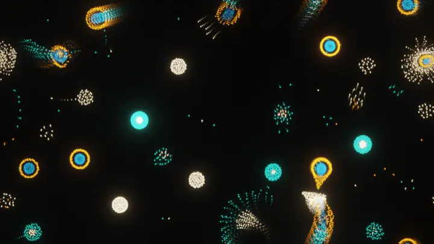
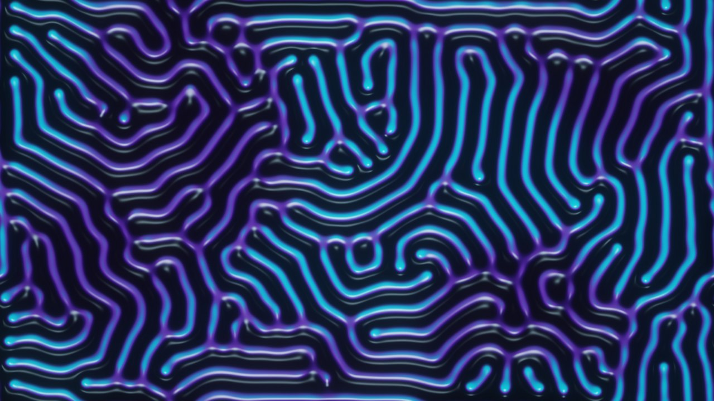
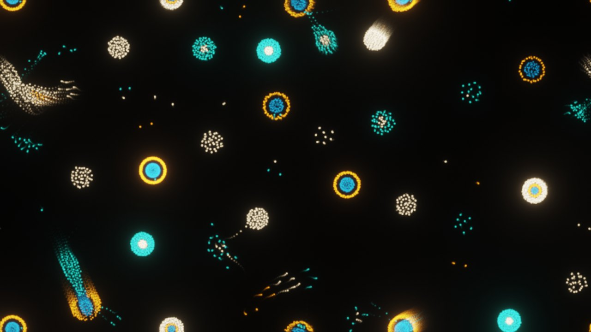
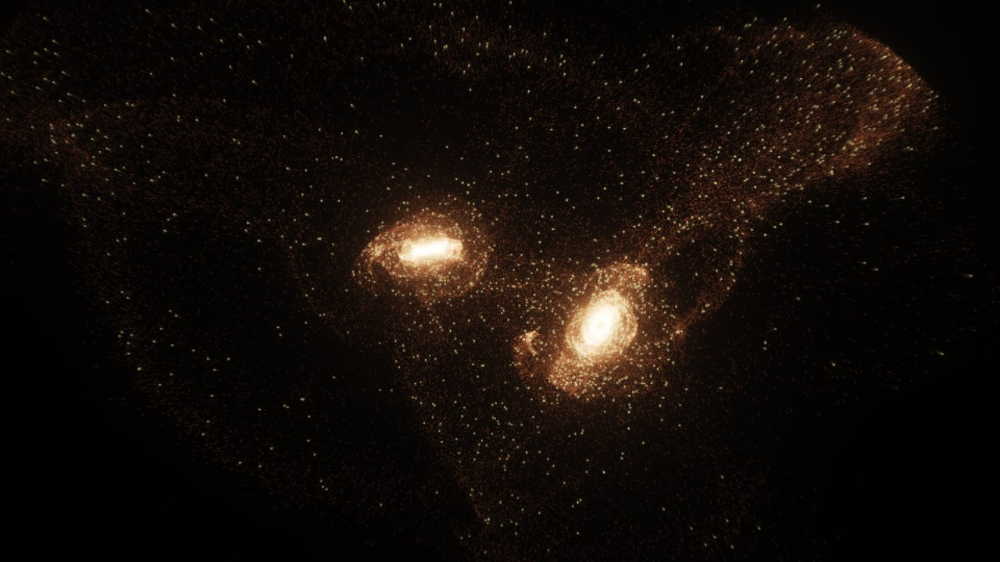
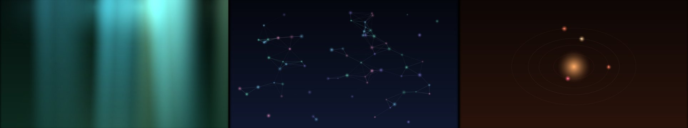

<div align="center">

# Aether

*Started with an inkling.*

**A GPU live wallpaper of particles, fluids and fractals that never repeats.**



Ten real-time simulations on your graphics chip, dissolving slowly from one
into the next, behind your windows on Ubuntu / GNOME, with native hosts for
Windows and macOS.

[Scenes](#the-scenes) ·
[Quick start](#quick-start) ·
[Make it your wallpaper](#make-it-your-wallpaper) ·
[Windows](#windows) ·
[macOS](#macos) ·
[How-tos](#how-tos) ·
[On the web](#on-the-web) ·
[How it was made](#how-it-was-made)

</div>

---

## The scenes

Every time a scene comes on screen it gets a fresh seed, shape, palette and
running time, and its parameters keep drifting while you watch. You will
never see the same picture twice.

<table>
<tr>
<td width="50%"><br><b>Silk</b>: 262k particles riding 3D curl noise, leaving luminous threads that keep re-braiding</td>
<td width="50%"><br><b>Physarum</b>: half a million slime-mold agents growing transport networks, with up to three rival species</td>
</tr>
<tr>
<td><br><b>Attractor</b>: Clifford and de Jong maps piled into glowing density fields that fold and re-bloom</td>
<td><br><b>Reaction</b>: Gray-Scott reaction-diffusion as lit enamel: coral, mitosis, mazes and spirals invading each other</td>
</tr>
<tr>
<td><br><b>Ink</b>: a stable-fluids simulation stirred by unseen brushes that bleed coloured ink</td>
<td><br><b>Julia</b>: Julia sets of z²+c as c glides along the edge of the Mandelbrot set</td>
</tr>
<tr>
<td><br><b>Particle Life</b>: species with lopsided attractions forming cells, worms and chasers; heat waves melt crystal into gas</td>
<td><br><b>Galaxy</b>: spiral galaxies on a close encounter, throwing out tidal tails and bridges</td>
</tr>
<tr>
<td><br><b>Chaos</b>: 3D strange attractors (Lorenz, Aizawa, Thomas, Halvorsen, Dadras, Rössler) pouring from one shape into the next</td>
<td><br><b>Nebula</b>: a calm interlude of domain-warped gas and twinkling stars</td>
</tr>
</table>

**Why it never feels like it's on repeat.** While a scene is on screen, its
parameters glide between random waypoints: feed and kill rates, sensor
angles, attraction matrices, attractor coefficients, camera paths and
palettes. Some scenes also have events: new seeds in Reaction, heat waves in
Particle Life, morphs between systems in Chaos, the collision in Galaxy. The
scheduler never picks any of the last four scenes again.

**Calm by design.** Slow cameras and parameter drift, no hard cuts, bloom and
filmic tone-mapping with soft highlights, dithering against banding, and a
gentle auto-exposure so every scene sits at a similar brightness.

## Quick start

You need:

- **OpenGL 4.3.** Any Intel HD 5xx / UHD 6xx or newer with Mesa, and most
  GPUs from the last decade.
- **`python3` with PyGObject and GTK 4.** On Ubuntu that's
  `sudo apt install python3-gi gir1.2-gtk-4.0`. There are no pip installs:
  OpenGL is called through a small ctypes layer (`aether/gl.py`).
- **Pillow** *(optional)*, only for screenshots and contact sheets:
  `sudo apt install python3-pil`.

Then:

```bash
git clone https://github.com/jtalbott22/wallpaper.git
cd wallpaper
python3 -m aether --windowed
```

| Key | Action |
|---|---|
| `Space` / `N` | Next scene |
| `P` | Pause / resume |
| `F11` | Toggle fullscreen |
| `Esc` | Quit |

## Make it your wallpaper

A normal Wayland app can't put itself behind the desktop, so the repository
ships a small GNOME Shell extension (`gnome-extension/`) that does it for you.
It works with GNOME Shell 48–51.

**1. Install it**

```bash
./install-wallpaper.sh
```

**2. Log out and back in once.** On Wayland, GNOME only notices a new
extension at login. After that, Aether starts with your session.

What the extension does:

- launches `python3 -m aether --wallpaper` at login, restarts it if it exits,
  and falls back to the older CPU renderer, [Mirage](#mirage-the-original-cpu-renderer),
  if Aether keeps failing (for example, no OpenGL 4.3)
- puts the window in the desktop layer, below Desktop Icons and every other
  window, on all workspaces, hidden from the dock, Alt-Tab and Overview
- sizes it to the primary monitor
- **pauses rendering** while a maximized or fullscreen window covers the
  screen, and while the screen is locked, so it costs nothing while you work
- adds an **Aether menu to the top bar**, with the same ring-and-swirl icon as
  the macOS menu bar item:
  - a brightness slider (5–150%)
  - pause and resume
  - pick one scene or let it move through all of them, and skip to the next scene
  - open the [interactive web version](#on-the-web) in your browser
  - restart the wallpaper

  Your choices are saved in `~/.config/aether/wallpaper.json`, and the renderer
  re-reads them on `SIGHUP`, so changes apply without a restart. After updating
  from an older version, log out and back in once to get the menu.

**Limits:** it covers the primary monitor only, and it doesn't react to the
mouse (the desktop window doesn't receive pointer events).

## Windows

On Windows, a small native host (`windows/`, C# / .NET 8 with WebView2) runs
the [web version](#on-the-web) — all ten scenes — behind the desktop
icons on every monitor.

**1. Install the [.NET 8 SDK](https://dotnet.microsoft.com/download/dotnet/8.0)**
(or newer). Windows 11 already has the WebView2 Runtime it needs.

**2. Build and install it** from PowerShell in the repository:

```powershell
.\windows\install.ps1 -StartAtLogin
```

That puts it in `%LOCALAPPDATA%\Programs\Aether` and the Start menu, starts
it, and starts it at every login. Run the script again to update; `-Uninstall`
removes it.

Its tray icon (the same Aether mark as on macOS, GNOME and the web) has a
brightness slider, pause and resume, a scene picker, next scene, "Open Aether
in browser" and "Start at login". It pauses on its own on any monitor a maximized or
fullscreen window covers, while the session is locked, and in battery saver.
It works with both the classic and the Windows 11 24H2 desktop layout and
reattaches when Explorer restarts. See [windows/README.md](windows/README.md)
for building from source, options and troubleshooting.

## macOS

On macOS, a small native host (`macos/`, Swift with WKWebView) runs the
[web version](#on-the-web) — all ten scenes — as the desktop
background, under the icons, on every screen and every Space.

**1. Install the Swift tools** if you don't have Xcode: `xcode-select --install`.
It needs macOS 13 or newer.

**2. Build and install it** from Terminal in the repository:

```bash
macos/build.sh --install --open-at-login
```

That puts `Aether.app` in `~/Applications`, opens it, and opens it at every
login. Run the script again to update; `--uninstall` removes it. An app you
built yourself opens normally; if you copy it to another Mac, allow it once
in System Settings › Privacy & Security (**Open Anyway**).

Its menu bar item has a brightness slider, pause and resume, a scene picker
and "Open at Login". It pauses on its own on any screen whose desktop is fully
covered (including by fullscreen apps), while the screen is locked or asleep,
and in Low Power Mode. See [macos/README.md](macos/README.md) for building
from source, options and troubleshooting.

## How-tos

### Switch to the CPU renderer

```bash
./install-wallpaper.sh --engine mirage
```

Run `./install-wallpaper.sh` again with no options to switch back to Aether.

### Uninstall

```bash
./install-wallpaper.sh --uninstall
```

### Move the repository

The extension remembers where the repository lives. If you move or rename
the folder, run `./install-wallpaper.sh` again from its new location.

### Watch just one scene

```bash
python3 -m aether --list
```

```bash
python3 -m aether --windowed --scene "Galaxy"
```

### Make it lighter on a weak GPU

Lower the simulation resolution (0.4–1.0 of the screen, default 0.75) or the
frame rate:

```bash
python3 -m aether --windowed --quality 0.5 --fps 24
```

On battery Aether drops to 20 fps on its own (`--battery-fps` changes that).

### Measure your machine

```bash
python3 -m aether --bench
```

This prints the GPU time per frame for every scene at 1920×1080. On an
i7-8550U laptop with Intel UHD 620 graphics, scenes take about 5 ms (Chaos,
Galaxy) to 12–14 ms (Reaction, Julia, Attractor, Particle Life) against a
33 ms budget at 30 fps, using about 5% of one CPU core.

### Take screenshots

Both of these render headlessly, with no window or display needed:

```bash
python3 -m aether --preview out.png --scene Physarum --time 40
```

```bash
python3 -m aether --sheet sheet.png
```

`--preview` grabs one frame after `--time` simulated seconds. `--sheet` makes
a contact sheet of every scene at 8, 35 and 70 seconds. Add `--seed N` for a
different look and `--size WxH` to change the resolution. The images in this
README were made this way.

### See what it's doing

```bash
python3 -m aether --windowed --debug
```

```bash
journalctl --user -b | grep -i wallpaper
```

The first logs scene changes and frame rate in a window. The second shows
the extension's log, including the renderer's output.

### All options

| Option | Default | What it does |
|---|---|---|
| `--windowed` | | run in a normal window instead of fullscreen |
| `--wallpaper` | | wallpaper mode, used by the extension (`SIGUSR1` pauses, `SIGUSR2` resumes) |
| `--scene NAME` | | show only this scene |
| `--seed N` | random | repeatable runs |
| `--fps F` | 30 | target frame rate |
| `--battery-fps F` | 20 | frame-rate cap on battery |
| `--quality Q` | 0.75 | simulation resolution, 0.4–1.0 of the screen |
| `--debug` | | log scene changes and frame rate |
| `--list` | | list scenes and exit |
| `--preview OUT.png` | | render one frame headlessly and exit |
| `--time T` | 20 | simulated seconds before `--preview` grabs its frame |
| `--sheet OUT.png` | | render a contact sheet of every scene and exit |
| `--bench` | | measure per-scene GPU frame time and exit |
| `--size WxH` | 1920x1080 | size for `--preview`, `--sheet` and `--bench` |

### Add your own scene

1. Subclass `Scene` in a new file under `aether/scenes/`.
2. Implement `setup`, `step(dt)` and `draw()`. `draw()` renders HDR linear
   colour into `self.out`.
3. Add it to `REGISTRY` in `aether/scenes/__init__.py`.
4. Check it:

```bash
python3 -m aether --sheet x.png --scene "Name"
```

## On the web

[`web/aether-bg.js`](web/aether-bg.js) is a WebGL2 port of all ten scenes
made to sit behind a web page as a slow, subtle background. It's one 90 KB
file with no dependencies. As a page background it shows the calmer five
(Nebula, Julia, Reaction, Physarum and Attractor); add `data-scenes="all"` to
the canvas for all ten, as the desktop wallpaper page does. WebGL2 has no
compute shaders, so the particle scenes keep their particles in float
textures, move them in fragment shaders and draw them as points. You can see it live on
[joshuaallentalbott.com](https://joshuaallentalbott.com/), where it defaults to 20%.


<sub>At 100%: Nebula in light mode (left), Julia in dark mode (right).</sub>

**Add it to a page**

1. Copy `web/aether-bg.js` next to your page.
2. Put a canvas first inside `<body>`:

   ```html
   <canvas id="aether-bg" aria-hidden="true"></canvas>
   ```

3. Give it this CSS:

   ```css
   #aether-bg{ position:fixed; inset:0; width:100vw; height:100lvh; z-index:-1;
               pointer-events:none; opacity:0; transition:opacity 1.4s; }
   #aether-bg.on{ opacity:1; }
   @media print{ #aether-bg{ display:none; } }
   ```

4. Load the script at the end of `<body>`:

   ```html
   <script src="aether-bg.js" defer></script>
   ```

Sections with solid backgrounds hide it, so make them see-through
(`color-mix(in srgb, var(--wash) 84%, transparent)` works well).

**What it does**

- **Follows your theme.** It reads the page's `--paper` CSS colour and
  redraws when `data-theme` or the system theme changes. On a dark page the
  glow lights the paper; on a light page the same shapes become pale tints.
- **Parallax.** The field is 20% taller than the window and drifts up slower
  than the page scrolls, with a slight shift following the mouse.
- **Easy on devices.** It caps at 30 fps, pauses in background tabs, lowers
  its resolution on slow hardware, and shows one still frame when the visitor
  prefers reduced motion. Without WebGL2 it does nothing and the page looks
  as before. When it starts it adds `aether-ready` to `<html>`, so you can
  show controls only when it's running.

**Brightness**

| Setting | What it does |
|---|---|
| `data-level-default="0.2"` on the canvas | brightness for visitors who haven't chosen one (0–1.5, default 1) |
| `data-level-key="my-key"` on the canvas | `localStorage` key for the visitor's choice (default `aether-level`) |
| `dispatchEvent(new CustomEvent('aether-level', {detail: 0.6}))` | change it live, for example from a slider; 0 fades it out and stops drawing |

A slider only needs to save its value under the same key and send that
event. The script also picks up changes made in other tabs.

**As a desktop wallpaper on Windows and macOS**

[`web/wallpaper.html`](web/wallpaper.html) is a full-screen, full-strength version for wallpaper
hosts. The native hosts in [`windows/`](#windows) and [`macos/`](#macos) show
it behind the desktop icons. You can also use it with Lively Wallpaper (Windows)
or Plash (macOS); see [docs/PLATFORMS.md](docs/PLATFORMS.md) for how.

More canvas options: `data-strength` overrides the base strength, `data-pixels`
sets the resolution budget (default about 0.5 megapixels), and `data-parallax="0"`
turns parallax off.

**Play with it in a browser**

[`web/aether.html`](web/aether.html) is the full wallpaper experience in a tab, with
controls: all ten scenes, full screen, pick or hold a scene, pause, change the
speed (¼× to 3×), zoom in where you point (scroll or pinch) and drag to look
around, set the brightness, and save the current frame as a PNG. Press `?` on
the page for the keyboard shortcuts. Try it on
[joshuaallentalbott.com/aether.html](https://joshuaallentalbott.com/aether.html),
open the file locally, or use **Open Aether in Browser** in the Linux top bar menu.

Pages can drive the engine through `window.Aether`: `scenes()`, `scene()`,
`show(key)`, `next()`, `hold(bool)`, `pause(bool)`, `speed(x)`, `zoomAt(factor, x, y)`,
`pan(dx, dy)`, `resetView()` and `snapshot()`. It fires an `aether-scene` event
on `window` whenever a new scene starts.

**Show one scene**

Add `?aether=physarum` (or `nebula`, `julia`, `reaction`, `attractor`, `silk`,
`chaos`, `galaxy`, `ink`, `life`) to the
page URL to stay on one scene, which is handy for screenshots.

## How it was made

It started with an inkling, quite literally. This project was built by two AI
coding agents in about a day: first Inkling, a model running entirely on my
own hardware at home, then Claude.

### Act 1: a model running at home

It started on the evening of Monday, November 23, 2026, in
[opencode](https://opencode.ai) running **Inkling 2 Mini**, the new model
from Thinking Machines. It was served by llama.cpp from my
[Self-hosted AI Stack](https://github.com/jtalbott22/Self-hosted-AI-Stack)
on a GPU workstation at home. The prompt:

> Can you help me build a cool live wallpaper app for ubuntu? I want it to
> have beautiful particle and physics visualizations that aren't too jarring
> to look at but keep you curious about what will happen next. It should
> never feel like it's on repeat and endlessly change…

Over the next day Inkling built **Mirage**: twelve scenes drawn with pycairo
on the CPU, with a scheduler, eight palettes and an adaptive quality
controller. Along the way I asked it to fix visuals that were pinned to the
bottom-right corner, and whether it could run as my actual wallpaper.



| Inkling 2 Mini in opencode | |
|---|---|
| Ran | 7:36 pm Nov 23 → 4:47 pm Nov 24 |
| Model turns | 268 |
| Tool calls | 301 (217 shell, 77 file reads, 3 searches, 2 web fetches, 2 questions to me) |
| Time spent generating | 13.9 hours |
| Tokens out | 259k |
| Prompt tokens read from cache | 19.4 million |
| Context compactions | 4 |
| Result | Mirage: 2,040 lines of Python, 12 CPU scenes |
| Cost | $0, on my own hardware |

It worked, but it didn't wow me the way I'd hoped.

### Act 2: switching up to Claude

At 4:55 pm on November 24 I moved to Claude Code running **Claude Opus 5.5**.
First I asked it to get Mirage running as a real animated wallpaper on this
laptop. It wrote the GNOME Shell extension and the installer, and Mirage was
on my desktop about 13 minutes later.

Then I gave it the same original prompt and asked it to take its own crack
at it. It moved everything to the GPU: a dependency-free ctypes binding for
OpenGL 4.3, compute-shader simulations, noise dissolves between scenes, bloom,
ACES tone-mapping and auto-exposure. That became **Aether**, with Mirage kept
as the extension's fallback.

| Claude Opus 5.5 in Claude Code | |
|---|---|
| Ran | 4:55 pm → 5:51 pm Nov 24 (56 minutes) |
| Model turns | 258 |
| Tool calls | 125 (73 shell, 20 file writes, 16 file reads, 2 edits, 14 progress updates) |
| Tokens out | 648k |
| Result | Aether (3,484 lines of Python and GLSL, 10 GPU scenes) plus the GNOME extension (311 lines) |

### The takeaway

A model running entirely on hardware at home went from a one-paragraph idea
to a working, twelve-scene wallpaper overnight, for free. A frontier model
then took the same idea much further in under an hour. Both are in this repo,
and the home-built one is still the safety net.

---

## Mirage (the original CPU renderer)

Mirage is the first version: twelve pycairo scenes rendered on the CPU at
reduced resolution. It still works and is the extension's fallback when
Aether can't start.

```bash
./mirage.sh --windowed
```

```bash
python3 -m mirage --preview out.png --scene "Aurora Curtain" --palette aurora
```

**Scenes:** Nebula Drift · Plasma Rise · Liquid Flow · Constellation Drift ·
Quantum Interference · Aurora Curtain · Orbital Garden · Starfield Horizon ·
Fireflies Swarm · Ocean Swell · DNA Helix · Fractal Mirror

**Palettes:** midnight, ember, aurora, dusk, pearl, rose, forest and mono,
picked at random and never the same twice in a row.

Mirage also takes `H` to toggle the control hint, and reacts gently to the
mouse (or to a slow phantom drift when the mouse is idle).

<details>
<summary>All Mirage options</summary>

```
python3 -m mirage [--windowed | --wallpaper] [--seed N] [--scene NAME]
                  [--palette NAME] [--quality 0.30-1.00] [--fps F]
                  [--battery-fps F] [--debug]
python3 -m mirage --preview OUT.png [--scene NAME] [--palette NAME]
python3 -m mirage.preview --scene NAME --palette NAME --size WxH --frames N --out OUT.png
```

- `--windowed`: run in a normal window instead of fullscreen.
- `--wallpaper`: wallpaper mode for the extension, with no overlays or key
  controls; `SIGUSR1` pauses, `SIGUSR2` resumes.
- `--battery-fps F`: frame-rate cap on battery in wallpaper mode (default 15).
- `--seed N`: seed the first scene and palette, for repeatable runs.
- `--scene NAME`: force the first scene, for example `"Aurora Curtain"`.
- `--palette NAME`: force the first palette, for example `ember`.
- `--quality`: starting render scale, 0.30–1.00 (default 0.5). Mirage lowers
  it when frames get slow and raises it slowly when there's headroom.
- `--fps`: target frame rate (default 30).
- `--debug`: log scene changes and quality adjustments.
- `--preview OUT.png`: render one frame headlessly and exit.

</details>

## Project layout

```
install-wallpaper.sh   installs the GNOME Shell extension
gnome-extension/       extension that runs Aether (or Mirage) as the desktop wallpaper, plus the top bar menu
aether/                GPU renderer
  app.py               GTK 4 GLArea front end, frame pacing, wallpaper signals, battery
  engine.py            scene scheduling, noise dissolves, bloom, ACES tone map, auto-exposure
  gl.py                ctypes OpenGL 4.3 bindings and Program/Texture/Buffer helpers
  glsl.py              shared GLSL: hashes, simplex and curl noise, fbm, palette lookup
  palettes.py          15 curated gradient palettes that crossfade over time
  headless.py          surfaceless EGL context for previews and benchmarks
  preview.py           --preview, --sheet and --bench
  scenes/              one file per scene, plus base.py (Scene, Drift, camera helpers)
web/aether-bg.js       WebGL2 port for web pages and the Windows and macOS hosts (10 scenes)
web/wallpaper.html     full-screen page for Windows and macOS wallpaper hosts
web/aether.html        interactive full-screen page: scenes, speed, zoom, snapshots
windows/               native Windows host: WebView2 behind the desktop icons (C#, .NET 8)
macos/                 native macOS host: WKWebView at the desktop window level (Swift)
mirage/                CPU renderer
  app.py               GTK application: window, overlay, input, tick loop
  scheduler.py         scene and palette rotation, never back-to-back
  renderer.py          low-res surface, crossfade, full-screen upscale
  perf.py              adaptive quality controller
  sprites.py           cached soft glow and gradient sprites
  palettes.py          8 calm palettes
  preview.py           headless preview renderer
  scenes/              12 scenes, base class and registry
docs/screenshots/      images in this README, rendered with --preview
```

## License

[MIT](LICENSE)
